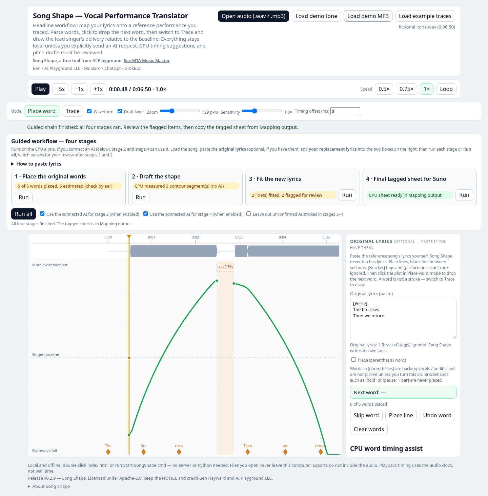

# Song Shape — local vocal performance translator

**Song Shape, a free tool from AI Playground.** See [MTA Music Master](https://www.aiplayground.spot/music-master). The in-app credit is a plain link: the app makes no request to the site unless you click it.

> **Disclaimer.** The original Song Shape has no tracking, analytics, accounts or data collection. Use the official repository as the verified source; copies from elsewhere may have been modified.
>
> **Official repository / report a bug:** https://github.com/aiplayground226/song-shape · [Issues](https://github.com/aiplayground226/song-shape/issues)

Song Shape turns a sung performance into a picture and a structured description of how the lead vocal rises, falls, holds, dips and recovers relative to the singer's baseline — then writes **your own new lyrics** with Suno-style performance tags that follow that shape. It runs entirely in your browser or with Node.js on your computer. The whole chain works on the CPU; a local or API AI and GPU tools can improve it, but are never required. Song Shape does not generate or clone voices, put audio in its exports, reproduce source melodies, or download lyrics.

**Credits:** Ben / AI Playground LLC - Mr. Bard / ChatGpt - GrokBot



## Install

There is nothing to install for the browser app.

1. Download this repository (green **Code** button → **Download ZIP**) or `git clone https://github.com/aiplayground226/song-shape.git`.
2. Open the folder. On Windows, double-click `Start-SongShape.cmd`; on macOS/Linux, open `index.html` in Chrome, Edge or Firefox.

Optional:
- **Node.js 18 or newer** for the command line (`cli/songshape.js`) and the test suite. No `npm install` is needed — Song Shape has no runtime dependencies.
- **ffmpeg** on your PATH (or `--ffmpeg <path>`) to analyze MP3 files from the command line. The browser decodes WAV and MP3 by itself.
- A **local AI** (Ollama, LM Studio, llama.cpp or any OpenAI-compatible server) for the optional AI stages. Browsers block `file://` pages from calling a local server, so start the app with `Serve-Local.cmd` (or `node tools/serve-local.js`, which listens on 127.0.0.1 only) when you use one.

## Quick start

**Browser (about two minutes):**
1. Open the app and click **Load demo MP3** (a synthetic tone), or **Open audio (.wav / .mp3)** with a song you have the right to use.
2. Paste the song's original lyrics into **Original lyrics (paste)** if you have them, and your new words into **Your replacement lyrics (paste)**. Plain lines, a blank line between sections. Any `[tags]` you paste are ignored.
3. In the guided panel, click **Run all**. It pauses after placing the words and after drafting the shape so you can listen and correct them; click **Continue after review**.
4. Copy the **final tagged sheet** into Suno, or save the project, report and AI handoff files.

**Command line (CPU only, no AI):**

```
node cli/songshape.js analyze demo/fictional_tone.wav examples/automatic_demo/reference.txt examples/automatic_demo/replacement.txt -o my-first-run
```

This writes `tagged-lyrics.txt` (the sheet), `project.json`, `visual-map.svg`, `visual-handoff.html`, `ai-handoff.json`, `ai-request.txt` and `QUALITY_CHECK.json` into the new folder `my-first-run`. It never overwrites an existing folder. Use `batch <folder> -o <out> --lyrics-dir <folder> --new-lyrics <file|folder>` for many songs, and add `--ffmpeg <path>` for MP3. `node cli/songshape.js --help` lists every option.

**Run the tests:** `node tests/run.js` (or double-click `Run-Tests.cmd`) — 123 tests, no network.

## Step by step — no AI, no GPU, no server

1. Download or clone this repository. On Windows, double-click `Start-SongShape.cmd`; elsewhere, open `index.html` in your browser.
2. Click **Open audio (.wav / .mp3)** and load the authorized reference lead-vocal recording. WAV and MP3 are decoded locally by your browser's built-in decoder (no libraries, nothing uploaded). Try **Load demo tone** (WAV) or **Load demo MP3**, or open `demo/fictional_tone.mp3` yourself. Paste the **reference lyrics** into the first Lyrics box and **your new lyrics** into My new lyrics.
3. To save time, click **Estimate remaining words (rough)**. This puts estimated lyric word markers on the timeline; **it does not recognize words or guarantee their boundaries**. A better option for each known line is to select a loop on the time ruler, then click **Estimate next line in loop**. Review and move anchors to your ear's correct timing.
4. Click **Analyze full local lead audio + add measured contour**. This uses local CPU frequency analysis and overlays an editable **computer-measured** draft. A user-made expressive trace is separate. If a phrase is wrong (or music/harmony is being tracked instead), manually redraw it in **Trace** mode. Frequency measurements alone do not determine emotional vocal delivery.
5. Click **Preview visual handoff**. The map shows your new words at estimated locations alongside the vocal shape. Click **Save picture PNG** and **Copy mapping request**. Send **both** to a vision-capable model if you choose. With a text-only local model, the structured events in the request are sufficient to ask for a draft.
6. Use **Build contour-directed sheet** for a deterministic, fully offline first draft, or connect a **deliberately selected AI** under Connect your AI. External endpoints are off until enabled and require an additional opt-in. No AI connection is required for the local draft.
7. Save **full local report HTML** for a readable reference, **AI handoff JSON** for machine parsing, and **Export JSON** for your editable complete local project. The editable project *does* contain the reference lyrics; the shared AI handoff exports do not.

The visual handoff includes **source-word timing evidence**, **a proposed projection of the expressive movement onto your replacement words**, and warnings. Projection into new syllables is an interpretive songwriting aid, **not an observed new vocal performance or exact melody transfer**. The operator remains responsible for fit, delivery, rights, and final instructions.

## Your inputs: one song file and two pasted lyric boxes

**Song Shape never downloads songs or lyrics** — not from the internet, not from anywhere. You give it:

1. **The song** — a `.wav` or `.mp3` you are allowed to use (Open audio).
2. **Original lyrics** — *optional*, paste them if you have them (box **Original lyrics (paste)**). They let Song Shape place the words on the timeline (stage 1). Without them you can place words by clicking, or work from the shape only.
3. **Your replacement lyrics** — the words you want sung with the same delivery (box **Your replacement lyrics (paste)** under Map my lyrics).

**How to format the lyrics (both boxes, and the `.txt` files for the CLI):**

```text
One sung line per line
Another sung line

A blank line between sections
The chorus lines
```

- Plain lyric lines, one sung line per line, a **blank line between sections**.
- **Section names are optional.** A line such as `[Chorus]` only marks where a section starts. Song Shape names the sections itself: a block whose lines repeat elsewhere becomes `[Chorus]`, the others `[Verse]`.
- **Tags you type are ignored.** Any `[bracket]` tag (`[Verse 2]`, `[Belting]`, `[Instrumental]`) and clear performance cues in parentheses (`(whispered)`, `(spoken)`, `(x2)`, `(ad-lib)`) are removed from both inputs and never appear in the output. The output uses **only Song Shape's own tags**. Unclear parentheses such as `(oh oh)` or `(softly, my love)` are kept as sung backing words and listed so you can check them.
- Leave out the song title, credits, chords and notes — they would be read as lyric lines.

### CPU delivery tags

Without any AI, Song Shape writes one `[Delivery: …]` tag per line from that line's measured rise and fall — direction (rising, falling, rise then fall, dip then recover, up-and-down, level), register, dynamics, sustained or held notes, the peak word, dips, how the line ends, phrase breaks and rhythm (full list in `SONG_SHAPE_AI_CONTEXT.md`). The tags **describe the performance; they are not varied for variety**: lines sung the same way get the same tags (a repeated chorus with the same contour repeats its tags), and tags change only where the contour changes. At most 8 cues per line.

## Guided workflow — four stages

The **Guided workflow** panel near the top of the page runs the whole chain. **Every stage runs on the CPU alone**; a connected AI and optional GPU tools only make stages better.

| Stage | CPU (always available) | With an AI connected (optional) |
|---|---|---|
| 1 · Place the original words | rough energy/syllable estimate, your clicks, or imported aligner timings | — (an external GPU aligner can feed it, see below) |
| 2 · Draft the shape | measured pitch contour becomes the trace | the AI drafts the trace per line window from the pitch grid, word timings and syllable counts (word text only if you tick the opt-in) |
| 3 · Fit the new lyrics | syllable-weighted projection onto your lines | uses AI strokes; unconfirmed ones are flagged (or left out if you tick the option) |
| 4 · Final tagged sheet | rule-based `[Global Vocal Direction]` / `[Delivery: …]` sheet | the AI writes the sheet; Song Shape checks that every lyric line is present and flags format problems |

Click a stage's **Run**, or **Run all**, which **pauses after stage 1** (listen and fix word positions) and **after stage 2** (listen and fix the shape), then **Continue after review**. Each stage shows its status (not run / running / review / done / failed).

**AI-drafted strokes stay "unconfirmed"** (dashed, tagged `needs_review`) until you click **Confirm selected AI stroke** or **Confirm all AI strokes**. Stages 3–4 include unconfirmed strokes with a review warning by default; tick **Leave out unconfirmed AI strokes in stages 3–4** to use only confirmed ones.

### Connect an AI (optional): local or API

Open **Connect your AI** and pick a preset:

| Preset | Base URL | Where it runs | Key |
|---|---|---|---|
| Ollama | `http://127.0.0.1:11434/v1` (model `qwen2.5:7b` suggested) | this computer | none |
| LM Studio | `http://127.0.0.1:1234/v1` | this computer | none |
| llama.cpp server | `http://127.0.0.1:8080/v1` | this computer | none |
| Other OpenAI-compatible | you type it | depends | optional |
| xAI (Grok) API | `https://api.x.ai/v1` | **remote** (data leaves your computer) | your xAI key |
| OpenAI API | `https://api.openai.com/v1` | **remote** | your OpenAI key |

- For the API presets, **type the exact model id** from your provider's model list; Song Shape does not guess it. Remote endpoints need the extra "Allow sending to LAN/cloud endpoints" tick (browser) or `--allow-remote` (CLI).
- Keys: in the browser, the key lives only in this tab's sessionStorage and is never exported. In the CLI, keys come **only from environment variables**: `XAI_API_KEY` (xai), `OPENAI_API_KEY` (openai), `SONGSHAPE_API_KEY` (other), or any name via `--api-key-env NAME`. Keys are never accepted on the command line or written to files or logs.
- Browser + API providers: whether xAI/OpenAI accept requests straight from a browser page (CORS) was **not tested** (no paid API was used). If the browser blocks it, use the CLI.
- Ollama: its default settings reject `file://` pages, so start `Serve-Local.cmd` and open `http://127.0.0.1:8765/`. Long songs with many lines: set `OLLAMA_CONTEXT_LENGTH=8192` (Ollama's default context is 4096 tokens; the stage-4 request for a full song can be longer).

### The AI context file

`SONG_SHAPE_AI_CONTEXT.md` (versioned; machine-readable copy `SONG_SHAPE_AI_CONTEXT.json`) tells the model what Song Shape is, the four stages, the data formats, the Suno tag conventions and the rules (keep every lyric line; no artist imitation; never invent breaths or notes). **It is placed at the start of the system prompt of every AI call** in the app and the CLI. Override it with **Load context file…** (this tab only; **Use built-in context** resets) or `--context my-context.md` in the CLI. The built-in copy lives in `js/ai-context.js`; after editing the `.md`, run `node tools/build-ai-context.js`.

### Optional GPU / external tools (opt-in, nothing installed)

The CLI can call two external tools you install yourself, like `--ffmpeg`. Nothing is detected or run unless you give a path; Song Shape installs nothing and runs tools without a shell.

- **Vocal separation** before analysis: `--separator <path> --separator-args "…" --separator-output "<template>"`. If the executable is named `demucs`, the preset `--two-stems=vocals -o {outdir} {audio}` with output `{outdir}/htdemucs/{name}/vocals.wav` is used (a **guess** based on demucs' documented defaults — verify with `demucs --help` for your version).
- **Forced alignment** for stage 1: `--aligner <path> --aligner-args "…" --aligner-output "<template>"`. The tool must write word JSON in the import format shown in the next section (WhisperX-style `segments[].words[]` also works). Example shape (a **guess**; adapt to your tool): `--aligner C:\tools\align.exe --aligner-args "{audio} {lyrics} {out}"`.
- **audio-separator** (python-audio-separator) works too; tested on Windows with a local MelBand-RoFormer model:
  `--separator "C:\path\to\audio-separator.exe" --separator-args "{audio} --model_filename vocals_mel_band_roformer.ckpt --model_file_dir 'D:\models' --output_dir {outdir} --single_stem Vocals --output_format WAV" --separator-output "{outdir}\{name}_(vocals)_vocals_mel_band_roformer.wav"`.
  Point `--model_file_dir` at models you already have, or the tool may try to download one.
- **Windows PowerShell 5.1:** inside `--separator-args` / `--aligner-args`, quote paths with **single quotes** as above. PowerShell 5.1 mangles double quotes nested inside an argument, and the tool then silently runs with its defaults.
- Placeholders: `{audio}` `{lyrics}` `{out}` `{outdir}` `{name}`; `--hook-timeout <seconds>` (default 1800). A GPU only speeds these external tools up; Song Shape's own code stays CPU.

## Optional: higher-accuracy local timing from another aligner

Song Shape can import strict, word-by-word **known-lyrics alignment proposals** produced by a local external tool. Use **Import offline word timings...** with either:

```json
{"words":[{"text":"The","start":0.40,"end":0.58,"score":0.98},{"text":"fire","start":0.59,"end":1.04,"score":0.96}]}
```

Here, `start`/`end` are seconds; alternatively, use `start_ms`/`end_ms`. An aligner may also use `segments:[{words:[...]}]` such as WhisperX-style outputs. **Every reference word must appear in the same order** and match the user's reference lyrics (excluding section tags); if text or count differs, the import is rejected without changing the project. Existing manual anchors are preserved. All imported timing proposals remain flagged for human review even at high reported model confidence; scores are not evidence of verified sung-word timing.

No alignment model, weights, forced aligner, stem splitter, or GPU runtime is bundled or downloaded. This is a strict **adapter**, not a claim that the built-in amplitude timing heuristic is forced alignment. To get genuine automatic word recognition/alignment, install and run an appropriate licensed local model separately, then import its output.

## Optional: the full chain from the command line (Node.js)

Install Node.js locally (the browser does not require it). From this extracted directory:

```bat
node cli\songshape.js analyze "C:\audio\lead.wav" "C:\lyrics\reference.txt" "C:\lyrics\my-new-song.txt" -o "C:\SongShapeResults\song01"
```

That runs stages 1→2→3→4 on the CPU and writes `project.json` (private, editable), `performance-map.json` (private, contains reference lyrics), `ai-handoff.json` (reduced data), `ai-request.txt`, `tagged-lyrics.txt`, `visual-map.svg`, `visual-handoff.html` and `QUALITY_CHECK.json` (with a per-stage `chain` log). The output folder must be empty or new; nothing is overwritten.

- **MP3:** add `--ffmpeg "C:\ffmpeg\bin\ffmpeg.exe"` (Node has no MP3 decoder; none is bundled).
- **With AI:** add `--provider ollama` (or `--endpoint … --model …`). The AI drafts stage 2 per line window and writes an extra `ai-tagged-lyrics.txt` plus `ai-sheet-check.json`; the CPU `tagged-lyrics.txt` is always written too. If the AI fails, stage 2 falls back to the CPU shape and the log says so. Options: `--send-word-text`, `--chunk-seconds N`, `--no-ai-sheet`, `--exclude-unconfirmed-ai`, `--context file.md`.
- **Real word timings:** `--alignment aligned-words.json`, or `--aligner …` (see above).
- **Many songs, full chain:** `node cli\songshape.js batch "D:\Songs" -o "D:\Out\run1" --lyrics-dir "D:\Lyrics" --new-lyrics "D:\NewLyrics"` (CPU only; reference lyrics matched by file name, `song.wav` ↔ `song.txt`; `--new-lyrics` may be one file for all songs or a folder matched by name). `ai-batch` with the same options plus AI options does the same with AI. Never overwrites, `--resume`, `--limit N`, per-song `batch-log.jsonl` and a summary. Songs without a lyrics file are listed as `skipped_no_lyrics`.
- **Stage 4 only:** `node cli\songshape.js ai-sheet project.json my-new-song.txt --provider ollama -o sheet.txt` (same send-and-check as the app's **Send to connected AI**).
- **Confirm AI strokes:** `node cli\songshape.js confirm project.json -o project-confirmed.json --all` (or `--stroke stroke-3`).

Alternatively run `Run-Three-Inputs.cmd`, which asks for the three input file paths and a new output folder. Run `node cli\songshape.js` with no arguments for every option.

To regenerate a handoff after manual correction:

```bat
node cli\songshape.js handoff "C:\SongShapeResults\song01\\project.json" "C:\lyrics\my-new-song.txt" -o "C:\SongShapeResults\song01-revised"
```

The other v0.2 CLI commands remain usable: `draft`, `sheet`, `map`, `request`, and `validate`.

## AI learns from your hand traces (optional, off by default)

Open **Connect your AI**, choose Ollama / LM Studio or any OpenAI-compatible server, tick **Enable**, then under **AI learns from your hand traces**:

1. Add examples: **Use current hand traces as an example** and/or **Add example projects (.json)…** (finished Song Shape projects; up to 5). Only hand-drawn strokes are used; machine-measured and AI-drafted strokes are ignored. Examples stay in the tab's memory and are never saved or exported.
2. Load the new song (.wav or .mp3) and click **Draft trace with AI**. Song Shape measures the pitch contour locally and sends only that compact contour plus your example traces — no audio, no lyrics. With no examples it drafts zero-shot from the audio features alone.
3. The AI strokes appear **dashed magenta**, tagged `ai_drafted_trace` and `needs_review`. Play the song and correct by ear: delete strokes or redraw them in Trace mode. **Remove AI-drafted strokes** clears them without touching your own strokes.

**Connecting the browser app to Ollama (tested with Ollama 0.40.17).** Ollama's default security setting rejects pages opened directly from disk (`file://`; Chrome reports their origin as `null`), so **Send** shows "Failed to fetch". Two options:

- **Recommended:** run `Serve-Local.cmd` (or `node tools\serve-local.js`) and use Song Shape at `http://127.0.0.1:8765/`. Ollama accepts this with its default settings. The helper serves only this folder, only to this computer, read-only.
- Not recommended: start Ollama with `OLLAMA_ORIGINS=*`. This lets the `file://` page connect, but it also lets **any website you visit** call your local Ollama.

The command-line `ai-draft` / `ai-batch` commands are not affected by this browser rule.

Optional **JSON mode** asks the server for strict JSON (Ollama and llama.cpp support it; turn it off if LM Studio rejects it). Small local models (1–2B) give rough drafts; larger models follow the examples better. Treat every AI stroke as a proposal.

### Many songs without hand work, stage 2 only (CLI)

For the full chain per song use `batch` / `ai-batch --lyrics-dir` (above). Without `--lyrics-dir`, `ai-batch` runs stage 2 only:

```bat
node cli\songshape.js ai-batch "D:\Songs" -o "D:\SongShapeAI\run1" --endpoint http://127.0.0.1:11434/v1 --model qwen2.5:1.5b --examples-dir "D:\MyTraces" --json-mode
```

- Processes every `.wav` in the folder (add `--recursive` for subfolders, `--ffmpeg <path>` to include `.mp3`), one song at a time, and writes `<song>.songshape.json` projects (measured draft + AI-drafted strokes) plus `batch-log.jsonl` and a summary.
- Running the command is the explicit send action. A non-local endpoint is refused unless you add `--allow-remote`. An API key is read only from an environment variable (`--api-key-env NAME`), never from the command line, and is never written to any file.
- It never overwrites: the output folder must be new or empty; `--resume` continues an interrupted batch and skips finished songs; `--limit N` processes N songs per run.
- Single song: `node cli\songshape.js ai-draft song.wav --endpoint … --model … -o song.songshape.json`. Omit `--examples` for zero-shot.
- Scale note: one song is one model call. At ~10 s per song on a CPU-only 1.5B model that is roughly 11–12 days for 100,000 songs; a GPU server or a faster model shortens this. Batch runs are resumable.

## What runs on the CPU / GPU

- **Browser CPU standard (implemented):** waveform display, manual word anchoring and tracing, **rough** energy/syllable positioning, pitch/RMS draft, word/line contour projection, rule-based tags, visual SVG/PNG, HTML, JSON and AI request exports. All offline, no accounts or additional packages.
- **High-end CPU (implemented, faster hardware may help):** same code can analyze longer recordings using available CPU resources. Hardware increases speed, not intrinsic accuracy.
- **NVIDIA or other GPU (opt-in hooks only):** Song Shape contains no CUDA code or model weights. The CLI can call your own GPU tools (vocal separation such as demucs, a forced aligner) through `--separator` / `--aligner`; their output feeds the same import path. Browser GPU rendering is not GPU audio analysis.
- **Local LLM or API (optional):** Ollama, LM Studio, llama.cpp, any OpenAI-compatible endpoint, or the xAI / OpenAI APIs (remote, explicit opt-in) may be configured by the user. Text-only models receive structured timing/contour descriptions. Image-capable models can receive the separately exported PNG if the user deliberately attaches it. A `localhost` endpoint may itself forward to a hosted model, so choose and verify genuinely local inference when strict offline operation matters.

## Accuracy and trust

**The end-to-end handoff is operational; automatic human-equivalent word timing is NOT achieved or established.** The CPU time estimator uses amplitude/onsets and an English-vowel syllable heuristic; it is not a singing-trained forced aligner. It can be wrong with intros, ad-libs, repeats, sustained words, instrumental tracks, or dense harmonies. Measured frequency tracking can follow instruments or backing singers. The new words' alignment is inferred from syllable proportions, not measured audio. Gaps do not prove a breath. Suno and other music generators are not guaranteed to obey tags.

Before real-world claims, compare machine results against human-marked ground truth on permitted isolated lead recordings, repeated phrases, overlap harmonies and long held notes. Report word boundary error, wrong-voice tracking, human correction time, and the effect on the requested musical performance. See `RELEASE_v0.2.5.md` and `RELEASE_v0.2.6.md`.

## Testing and privacy

Run `node tests/run.js` (Windows: `Run-Tests.cmd`): 123 tests, no network access, no dependencies. The optional browser checks `tests/headless_check.mjs` (loads the app from `file://` and runs the guided chain) and `tests/network_probe.mjs` (fails if the page makes any outbound request) need Chrome or Chromium and `npm install puppeteer-core` in a scratch copy; set `CHROME_PATH`.

**No telemetry, sign-in, mandatory internet, server, or remote dependencies.** Local input audio stays local; exports never contain audio bytes. Editable project JSON includes source lyrics; reduced AI request, PNG, HTML and handoff JSON include your replacement lyrics but omit source lyric text and original source artist by default. Exported filenames for AI sharing do not reveal the audio title. Audio, original lyrics, LLM decisions and copyright permissions remain user-controlled. See `PRIVACY.md` and `SECURITY.md`.

## Contributing and bug reports

Please report bugs as [GitHub issues](https://github.com/aiplayground226/song-shape/issues) using the bug report template (steps to reproduce, a short song or lyrics sample you are allowed to share, and the version from the app footer or `node cli/songshape.js --help`). Fixes are made by the maintainers on `main`; we do not merge pull requests from forks. When your report leads to a fix, you are credited by name or handle in `CHANGELOG.md`. Details: `CONTRIBUTING.md`. Please don't attach copyrighted audio.

## License and credit

**Credits:** Ben / AI Playground LLC - Mr. Bard / ChatGpt - GrokBot

Song Shape is licensed under the **Apache License 2.0** (`LICENSE`); commercial use is allowed under its terms. Copyright 2026 Ben Hayward and AI Playground LLC. The `NOTICE` file must be kept in redistributions and derivative works.

**Forks and derivatives:** please keep `NOTICE`, credit **Ben Hayward and AI Playground LLC** (https://www.aiplayground.spot), and link back to the original source repository (https://github.com/aiplayground226/song-shape). We'd love to see how you improve it.
